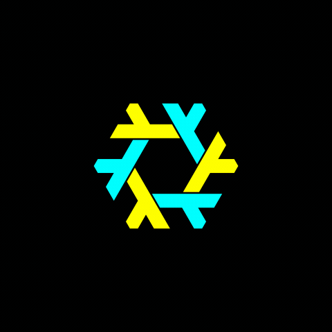

# Plymouth NixOS Backflip Theme

A springy Nix-logo Plymouth theme. Two alternating trios backflip into each
other's places, with colors you choose in Nix.



480×480 · 50 fps · 1.2-second loop. Nix renders the frames at build time;
boot only plays cached PNGs. Includes password prompts and boot messages.

## NixOS

```nix
{ pkgs, lib, ... }:
{
  boot.plymouth =
    let
      source = pkgs.fetchFromGitHub {
        owner = "Go08er";
        repo = "plymouth-nixos-backflip-theme";
        rev = "FULL_COMMIT_SHA";
        hash = lib.fakeHash;
      };
      theme = pkgs.callPackage "${source}/goobnix-plymouth" {
        oddColor = "#FFFF00";
        evenColor = "#00FFFF";
        size = 480; # Optional: 320 uses less memory.
      };
    in {
      enable = true;
      theme = "goobnix";
      themePackages = [ theme ];
    };
}
```

Pin a commit, then replace `lib.fakeHash` with the quoted `got:` hash from
the first build. Replace your previous Plymouth theme configuration, run
your usual NixOS rebuild, and reboot. Colors use `#RRGGBB`.

Experimental: build and script checks pass; real boot testing is still pending.
Verified on x86_64 Linux with Manim 0.21.0 and Plymouth 26.134.222.

[Build, test, and customize the animation →](docs/development.md)

Code: [MIT](LICENSE). NixOS logo: [attribution and license](NOTICE).
